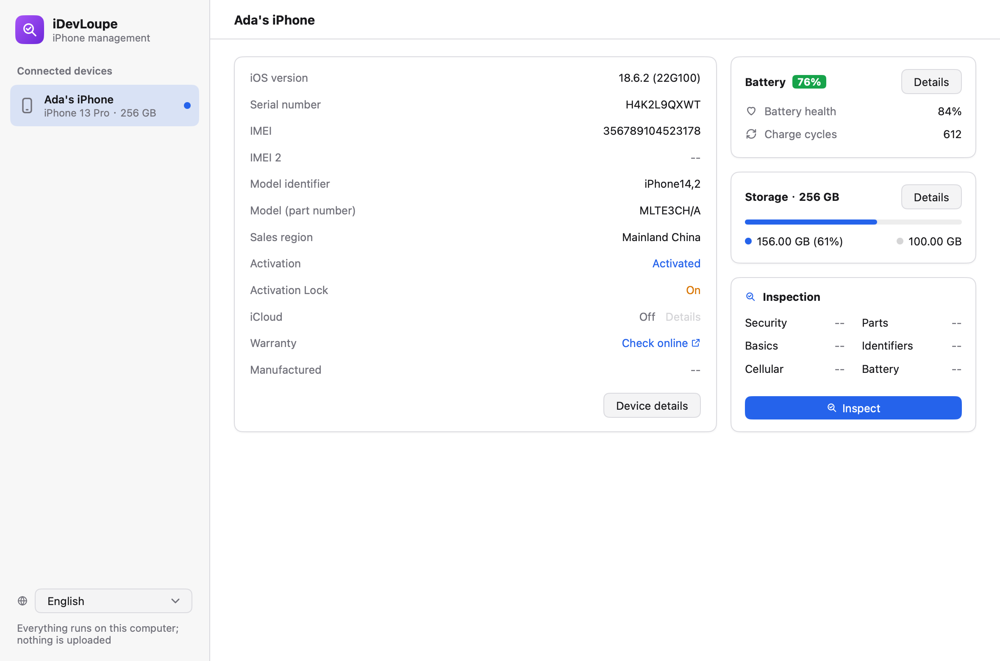

# iDevLoupe

A native desktop iPhone manager written in Go with [MyGo](https://github.com/egoist/mygo).
For now it inspects: connect an iPhone by cable and it judges what the phone reports about itself,
item by item and on evidence alone.



- **Locks and management**: Activation Lock, supervision, MDM, configuration profiles.
- **Parts**: serials against the factory record, parts made after the device, Face ID and Touch ID self tests.
- **Identity**: model, region, unit type, and whether every source agrees on serial and model.
- **Battery**: health against Apple's 80% and rated cycles, evidence of a replacement.
- **Private**: offline; the phone number and SIM numbers never reach a report.
- **Readable**: English, Simplified Chinese and German; export as text or JSON.

How each check decides, and the code layout: [docs/inspection.md](docs/inspection.md).

## Download

[GitHub Releases](https://github.com/ac0d3r/idevloupe/releases/latest) for macOS, Windows and Linux.
Needs usbmuxd: built into macOS; on Windows install Apple Devices or iTunes; on Linux install `usbmuxd`.

## Development

```sh
make run          # open the window
make test         # vet + tests, end-to-end against a fake usbmuxd and device
make lint         # golangci-lint v2
make build        # package for this platform, into build/<os>-<arch>/
make dist         # package for every platform; PLATFORMS=windows/amd64 picks some
make i18n         # regenerate after editing internal/locales/*.json
make screenshots  # regenerate the download page's screenshots
go run ./cmd/idevloupe -report   # print an inspection report (-json / -list / -lang)
```

## License

Copyright © 2026 ac0d3r. Licensed under the [GNU General Public License v3.0](LICENSE).

iDevLoupe is not affiliated with or endorsed by Apple Inc. iPhone, iPad and iOS are trademarks of Apple Inc.
Inspection results are for reference only.
